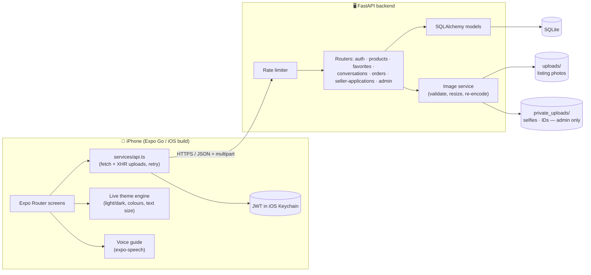

<div align="center">


### Pre-loved fashion, made easy.

A second-hand clothing marketplace for iPhone: browse real listings, sell your own after a quick identity check, and pay in cash on delivery.

[](https://github.com/DeonBeka/thriftLoop/actions/workflows/ci.yml)
[](https://github.com/DeonBeka/thriftLoop/actions/workflows/security.yml)


</div>

---

## Table of contents

- [Overview](#overview)
- [Features](#features)
- [Tech stack](#tech-stack)
- [Architecture](#architecture)
- [Getting started](#getting-started)
- [Configuration](#configuration)
- [Testing and quality](#testing-and-quality)
- [CI/CD](#cicd)
- [Security](#security)
- [API reference](#api-reference)
- [Project structure](#project-structure)
- [Roadmap](#roadmap)
- [License](#license)

## Overview

ThriftLoop is a hackathon project: a production-style **iOS marketplace for second-hand clothing**. It's a real React Native app (not a website) built with Expo, backed by a FastAPI and SQLite REST API.

- **Viewers** browse and search real listings, save favorites, chat with sellers and buy with **cash on delivery**. Delivery addresses can be picked on a map or typed.
- **Sellers** are viewers who passed a **live-selfie identity check** that an admin approved. They list items with multiple photos and manage incoming orders.
- **The admin** reviews seller applications, manages users and moderates listings.

The app follows native iOS conventions: real swipe-back navigation, skeleton loading, haptics, a warm serif-accented design system, light/dark mode, adjustable text size and a built-in **voice guide** for blind and low-vision users.

🎬 **[Watch the 1-minute demo video](ThriftLoop/demo/ThriftLoop-demo.mp4)**: a narrated tour of the app (AI stylist, Live View, basket and checkout, delivery across Kosovo, card payments, seller verification and fees).

## Features

<table>
<tr><td width="50%" valign="top">

**Marketplace**
- Home with category tiles, personalised picks and new arrivals
- Explore with debounced search, a filter sheet (size, price, condition) and sorting
- Product pages with a swipeable gallery, seller card and favorite button
- Favorites synced to the server and across screens
- Buyer–seller chat with unread badges, retry when a send fails, and polling

</td><td width="50%" valign="top">

**Buying and selling**
- Listing creation: up to 8 photos (camera or library), a preview before publishing, editing, mark as sold
- **Cash-on-delivery checkout** with a map picker ("use my location") or a typed address
- Order lifecycle: *pending → confirmed → delivered*, or *cancelled*. Products move *active → reserved → sold*
- Order updates are posted automatically into the chat

</td></tr>
<tr><td valign="top">

**Trust and roles**
- Three roles: viewer, seller and admin
- Seller verification with a live front-camera selfie and an optional ID photo
- Admin dashboard: stats, an application review queue, user management, moderation
- Terms of Service, Privacy Policy, Seller Terms and Cash-on-Delivery Terms, with acceptance tracking

</td><td valign="top">

**Accessibility and design**
- Light, dark and automatic themes, five button colours, three text and button sizes, all applied live
- **Voice guide**: announces each screen and reads items aloud. It stays quiet while VoiceOver is on
- VoiceOver labels, haptic feedback (can be turned off), skeleton loading
- Native iOS swipe-back navigation and sheet modals

</td></tr>
</table>

## Tech stack

| Layer | Technology |
| --- | --- |
| **Mobile app** | React Native 0.88, Expo SDK 58, TypeScript (strict), Expo Router (native stack and tabs), Reanimated 4, expo-image, expo-image-picker, expo-location, react-native-maps, expo-speech, expo-haptics, expo-secure-store |
| **Backend** | Python 3.12, FastAPI, Pydantic v2, SQLAlchemy 2, Uvicorn, Pillow (with HEIC support), bcrypt, PyJWT |
| **Database** | SQLite with foreign keys, cascades, indexes and lightweight auto-migrations |
| **Tooling** | pytest, Ruff, Bandit, pip-audit, npm audit, Gitleaks, CodeQL, Dependabot, Docker, GitHub Actions |

## Architecture



## Getting started

### Prerequisites

- **Python 3.11+** and **Node.js 20+**
- An iPhone with **[Expo Go](https://apps.apple.com/app/expo-go/id982107779)**, on the same Wi-Fi network as your computer
- A free **[Expo account](https://expo.dev/signup)**. This Expo Go version only opens projects when the phone and computer are signed in to the same account

### 1. Backend

```bash
cd ThriftLoop/backend
python -m venv .venv
# Windows: .\.venv\Scripts\activate    macOS/Linux: source .venv/bin/activate
pip install -r requirements.txt
cp .env.example .env              # Windows: copy .env.example .env
python -m app.seed                # demo sellers + 26 listings with real photos
uvicorn app.main:app --host 0.0.0.0 --port 8000 --reload --timeout-keep-alive 120
```

Interactive API docs: <http://localhost:8000/docs>

### 2. Mobile app

```bash
cd ThriftLoop/frontend
npm install
npx expo login                    # same account as in Expo Go
npx expo start                    # then scan the QR code with the iPhone camera
```

> On Windows PowerShell, use `npx.cmd` if script execution is disabled. The app finds the backend through the
> Metro host IP. Set `EXPO_PUBLIC_API_URL` in `frontend/.env` to override it.

### Demo accounts

| Role | Email | Password |
| --- | --- | --- |
| Seller | `maya.vintage@gmail.com` | `thriftloop123` |
| Seller | `leo.threads@gmail.com` | `thriftloop123` |
| Admin | the email you put in `ADMIN_EMAILS` | your own password |

New sign-ups start as **viewers** and can apply to sell from the Sell tab.

## Configuration

All backend settings live in `ThriftLoop/backend/.env` (never committed). See `.env.example` for the full list.

| Variable | Default | Purpose |
| --- | --- | --- |
| `ADMIN_EMAILS` | *(empty)* | Comma-separated admin accounts. This is the only way to become an admin |
| `JWT_SECRET_KEY` | auto-generated | Token signing key. Generated and stored on first start if it isn't set |
| `REQUIRE_EMAIL_VERIFICATION` | `false` | `true` turns on the 6-digit email code at sign-up |
| `SMTP_USERNAME` / `SMTP_PASSWORD` | *(empty)* | A Gmail account and App Password for sending the codes |
| `EMAIL_DEV_MODE` | `false` | Print codes to the server console instead of emailing them |
| `RATE_LIMIT_PER_MINUTE` | `120` | General requests per user or IP |
| `RATE_LIMIT_AUTH_PER_MINUTE` | `10` | Sign-in and sign-up attempts per IP |
| `RATE_LIMIT_UPLOAD_PER_MINUTE` | `20` | Photo uploads per user |
| `SEED_DEMO_DATA` | `false` | Seed demo data into an empty database on startup |

## Testing and quality

```bash
# Backend
cd ThriftLoop/backend
pytest -q                          # API tests: auth/OTP, roles, seller approval, orders, rate limits
ruff check app tests               # lint
bandit -c pyproject.toml -r app    # security static analysis
pip-audit -r requirements.txt      # vulnerable dependencies

# App
cd ThriftLoop/frontend
npx tsc --noEmit                   # strict type-check
npx expo export --platform ios     # full production bundle
npm audit --omit=dev --audit-level=high
```

## CI/CD

All pipelines live in [`.github/workflows`](.github/workflows) and run on GitHub Actions.

| Workflow | Trigger | What it does |
| --- | --- | --- |
| **CI** (`ci.yml`) | push to `main`, pull requests | Backend: Ruff and pytest. App: `npm ci`, TypeScript check, iOS production bundle. Docker image build |
| **Security** (`security.yml`) | push, pull requests, weekly | Bandit, pip-audit, npm audit, Gitleaks secret scan, CodeQL (Python and TypeScript, on public repos) |
| **Release** (`release.yml`) | `v*` tag | Re-runs the tests, then builds the backend Docker image and the iOS and web app bundles, and attaches them to a GitHub Release |
| **Dependabot** (`dependabot.yml`) | weekly | Update PRs for pip, npm (Expo SDK pinned) and GitHub Actions |

To cut a release:

```bash
git tag v1.1.0
git push origin v1.1.0
```

The project is set up for local testing with Expo Go. Releases produce ready-to-ship build artifacts, but nothing is automatically deployed to a server.

## Security

Passwords are hashed with bcrypt. Sessions use JWTs stored in the Keychain, and every endpoint enforces roles. Verification photos are stored privately. Requests are rate-limited, and every upload is validated and re-encoded. Every change is scanned automatically.

See [SECURITY.md](SECURITY.md) for the full list and for how to report a vulnerability.

## API reference

<details>
<summary><b>Endpoints</b> (full interactive docs at <code>/docs</code>)</summary>

| Method | Path | Access |
| --- | --- | --- |
| POST | `/auth/register`, `/auth/login`, `/auth/verify-email`, `/auth/resend-code` | public |
| GET / POST | `/auth/me`, `/auth/accept-terms` | signed in |
| GET | `/products`, `/products/{id}`, `/products/options` | public |
| POST / PUT / DELETE | `/products`, `/products/{id}` | seller (own listings), admin (delete any) |
| GET / POST / DELETE | `/favorites`, `/favorites/{product_id}` | signed in |
| GET / PUT | `/users/{id}`, `/users/{id}/products`, `/users/me` | public / signed in |
| GET / POST | `/conversations`, `/conversations/{id}`, `/conversations/{id}/messages` | participants |
| GET / POST | `/seller-applications/me`, `/seller-applications` | signed in |
| GET / POST | `/orders`, `/orders/{id}`, `/orders/{id}/status` | buyer / seller of the order |
| GET / POST / PATCH | `/admin/stats`, `/admin/applications…`, `/admin/users…` | admin |

</details>

## Project structure

```
thriftLoop/
├── .github/
│   ├── workflows/          ci.yml · security.yml · release.yml
│   └── dependabot.yml
├── SECURITY.md
└── ThriftLoop/
    ├── backend/            FastAPI API
    │   ├── app/
    │   │   ├── core/       config, security (bcrypt/JWT/OTP), auth deps, rate limiter
    │   │   ├── models/     User, Product, ProductImage, Favorite, Conversation, Message,
    │   │   │               SellerApplication, Order
    │   │   ├── routers/    auth, users, products, favorites, conversations, sellers, orders, admin
    │   │   ├── schemas/    Pydantic request/response models
    │   │   ├── services/   images, email (Gmail SMTP), serializers
    │   │   └── seed.py     demo data (real Unsplash photos)
    │   ├── tests/          pytest suite
    │   ├── Dockerfile · railway.json · pyproject.toml · requirements.txt
    └── frontend/           Expo app (iOS)
        ├── src/
        │   ├── app/        screens (Expo Router): (auth), (tabs), product, checkout, orders,
        │   │               messages, seller, admin, appearance, legal, settings
        │   ├── components/ ui · product · sell · checkout · orders · profile · skeletons · accessibility
        │   ├── constants/  live theme engine, catalog, legal texts
        │   ├── hooks/      useAuth, useFavorites, useApi, useUnreadCount
        │   ├── services/   API client, config, secure storage, preferences
        │   └── utils/      formatting, haptics, speech
        ├── app.json · eas.json · package.json
```

## Roadmap

- [ ] Real-time chat over WebSockets (currently polling)
- [ ] Push notifications for new messages and order updates
- [ ] Automatic face matching between the selfie and the ID (needs an identity-verification provider)
- [ ] Ratings and reviews after delivered orders
- [ ] PostgreSQL and object storage for multi-server deployments

## License

Released under the MIT License (see [LICENSE](ThriftLoop/LICENSE)). Demo listing photos are from
[Unsplash](https://unsplash.com) and used under the Unsplash License. Photographers are credited in
`backend/app/seed_photos.py`.
